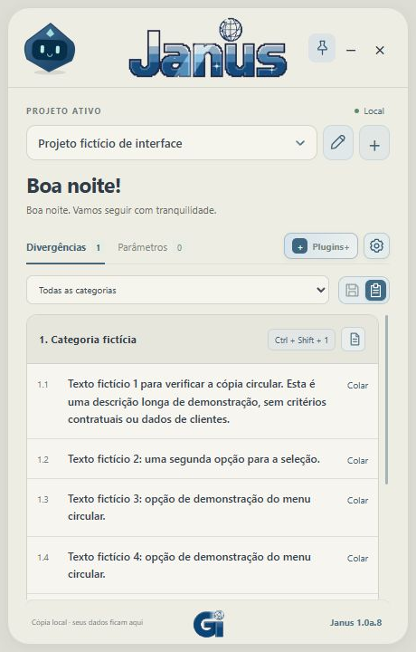
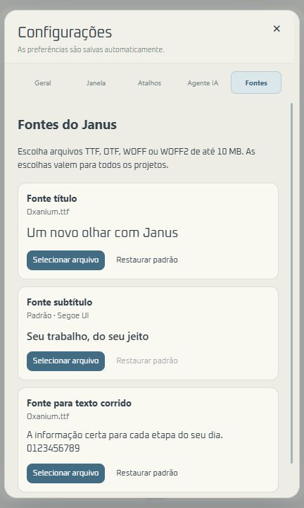

# Janus

Assistente portátil para Windows: consulta de divergências e parâmetros, atalhos globais, cópia e colagem, importação de PDF e conversa opcional com agentes de IA.

## Baixar Janus

[**⬇ Baixar Janus para Windows — portátil (.zip)**](https://github.com/kawanlemesgeourbano/janus/releases/download/v1.0a.8/Janus-Windows-portatil.zip)

Extraia o ZIP em uma pasta onde você possa salvar arquivos e abra **Janus.exe**. Sem instalador e sem execução como administrador. Windows de 64 bits com Microsoft Edge WebView2 disponível.

O programa começa sem projetos cadastrados. Quem usa 1.0a precisa fechar o Janus e substituir o executável uma vez, mantendo a pasta `dados`. Depois, o atualizador verifica novas versões ao abrir, baixa o pacote assinado e aplica ao fechar. Aguarde alguns segundos antes de abrir novamente.

[Detalhes do download e verificação SHA-256](https://github.com/kawanlemesgeourbano/janus/releases/tag/v1.0a.8). Esta é uma versão alpha.

## Painel clássico



O Janus acena ao entrar e reage ao mouse. No chat, ganha animações ao escutar, pensar e responder; também pisca ao fixar o painel. Os efeitos sonoros são sintetizados no próprio aplicativo, com timbre suave e volume mais perceptível. A reprodução é reativada na primeira interação se o ambiente bloquear o áudio automático. A opção Sons do Janus continua controlando todos os efeitos. Ao sair do mouse, recolhe na posição habitual; ao voltar, expande. O alfinete mantém sobre outras janelas e **Configurações → Janela → Recolher automaticamente** controla esse comportamento separadamente.

Plugins+ e configurações ficam à direita das abas Divergências e Parâmetros. A página de plugins mantém uma lista compacta, importação manual de layouts JSON compatíveis e a observação no rodapé. Downloads oficiais mantêm a validação de assinatura. Quando um pacote de atualização estiver pronto, **Atualizar e reabrir** fecha, aplica, valida e abre o programa novamente.

## Fontes · plugin opcional



Em **Plugins+ → Fontes → Baixar**, a aba **Fontes** aparece nas configurações. Selecione um arquivo para títulos, outro para subtítulos e outro para texto corrido. Os formatos aceitos são TTF, OTF, WOFF e WOFF2, até 10 MB por arquivo.

As fontes ficam salvas junto ao Janus e se aplicam a todos os projetos. **Restaurar padrão** desfaz uma escolha. Desativar o plugin recupera as fontes padrão sem perder as escolhas; remover exclui as fontes salvas por ele. Os arquivos escolhidos ficam somente no computador.

[Como usar o plugin de fontes](plugins/fontes/README.md)

## Menu circular · plugin opcional


No Janus, abra **Plugins+ → Menu circular → Baixar plugin → Ativar**. O menu circular e os seletores de cópia passam a usar setores ao redor do centro, com navegação por mouse e teclado. Todas as funções permanecem no círculo ampliado, incluindo chat e configurações. Os setores exibem apenas ícones e títulos em negrito, surgem ao passar o mouse e recolhem ao sair, mesmo com o alfinete ativo. Ao escolher uma função, as demais opções desaparecem. O fechamento e o alfinete ficam no próprio círculo.

Use **Plugins+ → Desativar** para voltar ao painel original, ou **Remover** para excluir o pacote. Trocar o projeto ativo não altera a ativação do plugin. O download é separado do executável e não é obrigatório.

[Conheça o plugin no GitHub](plugins/menu-circular/README.md) · [Formato e funcionamento](docs/PLUGINS.md)

## Dados dos projetos

Esta distribuição começa vazia. Não inclui projetos, critérios de contratos, documentos de clientes nem credenciais. Use **+** para cadastrar um projeto ou importar seu PDF. Revise os textos e orientações extraídos antes de utilizá-los.

Projetos e preferências ficam localmente em `dados/preferencias.json`, ao lado do executável. Essa pasta não deve ser publicada. Chaves de IA ficam no Gerenciador de Credenciais do Windows. O envio de contexto ao provedor é opcional no chat.

## Desenvolvimento

Pré-requisitos de desenvolvimento: Node.js LTS, Rust estável e ferramentas de compilação do Tauri para Windows.

```sh
npm ci
npm test
npm run build
npm run tauri build -- --no-bundle
```

O executável fica em `src-tauri/target/release/janus.exe`. Distribua somente o executável e os avisos de licença, sem preferências de testes. O usuário não precisa de instalador nem privilégios de administrador para uso normal em uma pasta gravável. WebView2 precisa estar disponível no Windows.

## Recursos e evolução

Personagem geométrico próprio em `src/avatar.ts`, sons sintetizados em `src/core/sound.ts`. Os recursos restritos do Coucou não estão incluídos. Logos Janus e GI fornecidas pelo responsável pelo projeto. Fontes com licenças em `public/fonts`.

O [atualizador portátil](docs/UPDATES.md) está disponível a partir de 1.0a.1. Configurações > Geral permite verificar agora ou desativar a busca automática. Plugins+ oferece [plugins opcionais de interface](docs/PLUGINS.md). Outros tipos de integração continuam em planejamento.

Base de código: Coucou, de Louis Raillé, sob MIT; aviso preservado em `LICENSE-COUCOU`. Consulte [os créditos](CREDITS.md) e [as condições dos recursos](LICENSE-ASSETS.md).

O download inclui os avisos de licença do código original, das fontes e das bibliotecas em `THIRD-PARTY-NOTICES.txt`. Retirar os recursos gráficos do Coucou não elimina a atribuição devida ao código que serviu de base.
