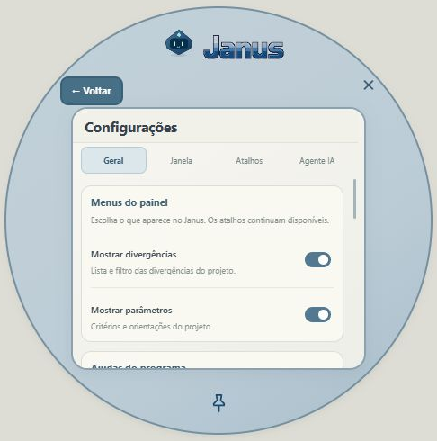

# Plugins opcionais

Para desenvolver, consulte o **[Guia completo para pessoas e modelos de IA](CRIAR-PLUGINS.md)**, com exemplo importável, tecnologias, limites e instruções de contribuição pelo GitHub. Para instalação e uso, continue abaixo.

Plugins+ oferece download, ativação, desativação e remoção. Nenhum plugin é instalado automaticamente com o Janus. A escolha é salva separadamente dos projetos em `dados/plugins` e continua igual ao trocar de projeto. Não há seleção de versões na interface.

## Primeiro plugin: Menu circular

Abre um menu em leque com divergências, parâmetros, Plugins+, agente IA e configurações. O Janus continua desenhando seu próprio personagem e logo. Todas as funções permanecem no modo circular. O centro se amplia para listas, parâmetros, Plugins+, chat e configurações; um único botão Voltar, destacado à esquerda, retorna ao início. Ao abrir uma função, os demais setores desaparecem.

- **Ctrl + Shift + D:** abrir/recolher o menu circular.
- **1 a 5, com o menu em foco:** abrir uma das cinco funções.
- **Ctrl + Shift + número:** abrir o seletor circular da categoria de divergência; repetir fecha, outra categoria substitui a seleção.
- **Setas:** navegar. **Enter:** copiar/colar a seleção. **Esc:** voltar.
- **Home/End e Page Up/Page Down:** navegar pelas opções e páginas. Categorias com muitas opções usam páginas de até cinco setores.
- O centro exibe o texto completo, com rolagem quando necessário, e permite mostrar/ocultar a orientação.

O modo C/V e as categorias continuam vindo do Janus. O plugin muda sua apresentação e não modifica os textos ou os critérios. A janela usa uma região nativa no Windows para que os espaços fora dos setores não bloqueiem o programa atrás dela. A área central vazia permite arrastar o menu.

## Formato aceito nesta implementação

Este primeiro formato é **declarativo**, para apresentação da interface. Não carrega JavaScript, CSS arbitrário, comandos nativos ou código baixado. Outros tipos de plugin precisam de novas APIs antes de serem suportados.

O arquivo [plugin.json](../plugins/menu-circular/plugin.json) define nome, descrição, paleta e as cinco ações conhecidas pelo host. A única permissão é `interface.layout`. Não há APIs de rede, arquivos, chaves de IA, leitura ou escrita de projetos disponíveis para o pacote. O host usa seus próprios dados para apresentar as contagens e as opções que o usuário está consultando.

O pacote distribuído é um JSON com `payload` em hexadecimal e `signature` Ed25519. O host valida a assinatura, o tamanho e o esquema antes de gravar e a cada inicialização. O assinador é `scripts/sign-plugin.py`; a chave privada deve permanecer fora do repositório. A chave pública é a mesma identidade de publicação do Janus.

```sh
python scripts/sign-plugin.py --key-file CAMINHO_PRIVADO --source plugins/menu-circular/plugin.json --output plugins/menu-circular/menu-circular.janus-plugin.json
```

Publique o pacote assinado no caminho do catálogo oficial somente depois de testar seu conteúdo no host. Os testes rejeitam permissões extras, cores fora do formato hexadecimal, ações desconhecidas, pacotes alterados e geometrias inválidas.


### Comportamento do menu

- O centro tem movimento sutil. Os setores surgem suavemente ao passar o mouse pelo círculo recolhido; recolhem após sair, mesmo com o alfinete ativo. A preferência de redução de movimento do Windows é respeitada.
- O alfinete mantém o Janus sobre outras janelas. Em **Configurações → Janela → Posição habitual**, escolha um canto; ao fixar, o menu respeita esse canto. Nos cantos da esquerda, os setores abrem para a direita.
- **×** encerra; o alfinete abaixo do logo fixa sobre as outras janelas. **Ctrl + Shift + D** continua abrindo/recolhendo o círculo.
- Todas as páginas ficam no círculo ampliado, com rolagem no conteúdo e uma única cabeça do assistente. Trocar de função não desativa o plugin.
- Quem já instalou o Menu circular recebe os ajustes de apresentação ao atualizar o Janus; não precisa reinstalar o pacote do plugin.

A abertura e o recolhimento usam a mesma janela e mantêm o centro imóvel. Os efeitos sonoros respeitam a preferência Sons do Janus. O setor Agente IA mostra o nome do provedor/modelo conectado quando houver conexão.




## Adicionar um arquivo local

Em Plugins+, use **Adicionar arquivo** para importar um JSON de até 40 KB. O Janus aceita o pacote assinado oficial ou o JSON de layout de `plugins/menu-circular/plugin.json`. A importação valida o esquema, as cinco ações conhecidas, cores e a permissão `interface.layout`, instala no espaço do layout circular e o ativa. Importar outro layout substitui o layout instalado nesse espaço; desativar volta ao painel clássico.

O arquivo local não precisa da assinatura do publicador, pois é selecionado diretamente pelo usuário. Downloads do catálogo continuam exigindo assinatura. Isso não permite importar JavaScript, Python, executáveis ou novas funções: este formato personaliza apenas o layout já suportado. Outros tipos de plugin exigem APIs futuras.

## Fontes da interface

O plugin opcional **Fontes** registra a aba Fontes nas configurações. O pacote oficial separado usa `schema: 1`, `id: fontes`, `kind: settings.fonts` e apenas `permissions: ["interface.typography"]`. A assinatura Ed25519 é obrigatória no download. O plugin é declarativo: não executa código baixado nem acessa projetos.

Há três papéis semânticos: `--font-title`, `--font-subtitle` e `--font-body`, com Segoe UI por padrão. A aba permite importar um arquivo TTF, OTF, WOFF ou WOFF2 de até 10 MB por papel. O carregador valida cabeçalho e carregamento real no motor de fontes antes de substituir a escolha anterior; arquivos inválidos mantêm a fonte anterior. Tamanhos, pesos e itálico continuam definidos pela interface. Logos desenhados em imagem ou canvas não mudam.

A instalação ativa o plugin e exibe a aba imediatamente. Desativar oculta a aba e restaura os padrões temporariamente; reativar recupera as escolhas. Remover apaga somente o pacote, o estado e as três fontes deste plugin. Não afeta Menu circular, projetos ou outras preferências.

No Windows os dados ficam em `dados/plugins/fontes.json`, `fontes-state.json` e `fontes-title.json`, `fontes-subtitle.json`, `fontes-body.json`. Cada arquivo de fonte armazena nome e bytes locais, sem depender do caminho original. Na prévia web, os bytes ficam no IndexedDB. Nenhuma fonte pessoal é enviada ao GitHub ou à IA. O atualizador preserva a pasta dados. A importação manual de layout continua exclusiva ao formato circular; Fontes deve ser instalado pelo botão Baixar.
